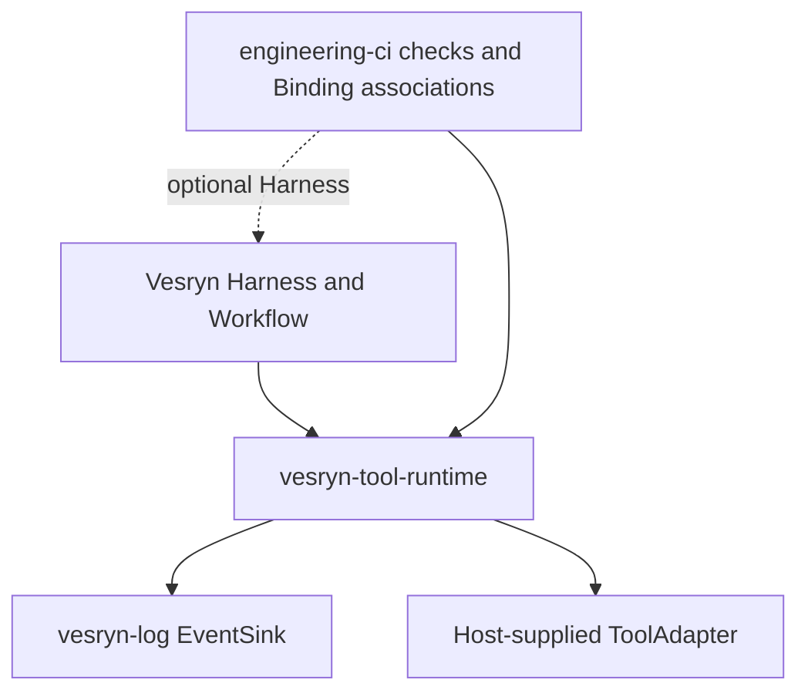

# Ownership and extraction

The authoritative ToolSpec, ToolResult, Invocation, ExecutionContext, ToolAdapter
and Catalog are migrated from Vesryn's current `workflow_core/contracts.py`.
Scope, canonical JSON and tool schemas move with them. Result validation and the
safe failure normalization formerly inside Workflow Runtime now live in
`vesryn_tool_runtime.invocation`. Explicit provider loading and scoped wrapping
move from the existing Registry; the Dagger introspection mapper is independent.

Binding integrity, identity checks, contract freshness, parameters and selection
scope are extracted from engineering-ci's existing Selection Binding Schema 1.
The original `workflow-selection-binding` kind is retained for compatibility.
Workflow association and execution ID fields remain accepted legacy metadata;
generic creation requires neither. Consumers own those associations and files.
engineering-ci adds its existing required workflow association to the shared
schema, generates its existing workflow, then computes the unchanged canonical
binding ID. Existing binding files remain readable.

Vesryn keeps the DAG, FSM, generation, checkpoints, capability lifecycle, retries,
manual write recovery, workflow history and shared tool implementations. It saves
all admitted attempt intents before calling ToolRuntime. Previous results are
still offered to their original Adapter for evidence verification. A resumed
uncertain write never gains automatic restart permission.

engineering-ci keeps ChecksAdapter grouping, Dagger execution, pipeline policy,
evidence freshness and engineering binding/workflow associations. No release,
download or unrelated CI/CD implementation is migrated. vesryn-log keeps its
existing API and all storage/archiving; this extraction does not modify that repo.

Only the consumers import their domain implementations. The independent package
has no imports of `vesryn` or `engineering_ci`, no Workflow and no Dagger SDK.
